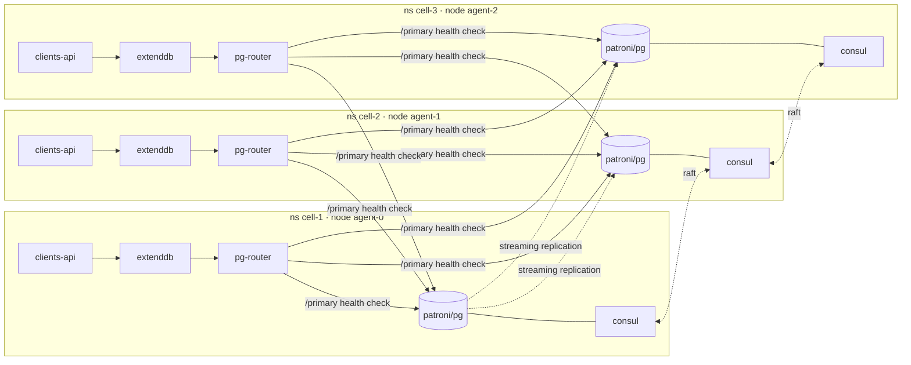

# ExtendDB on Patroni/Consul: a 3-cell lab on k3d

A local lab of a cell-based architecture. Each cell is its own namespace on its
own k3d node, and each runs the same stack:

| Component | What it does in the cell |
|---|---|
| **Consul** server | One of 3 Raft voters. Patroni's DCS (stores the leader lock). |
| **Patroni + PostgreSQL 17** | One member of the `extenddb-pg` cluster. One cell holds the primary; the other two stream from it. |
| **pg-router** (HAProxy) | Exposes `pg-primary` / `pg-replicas`. Checks all 3 Patroni REST APIs and follows the primary. |
| **ExtendDB** 0.1.13 | DynamoDB-compatible API (TLS + SigV4) backed by the shared Postgres cluster. |
| **clients-api** (Go) | Client-domain service. Talks to its cell's ExtendDB through the stock AWS SDK v2. |



The two clusters span the cells. Consul has 3 servers in one Raft cluster
(`bootstrap-expect=3`), and Postgres has 3 Patroni members under one scope.
Everything else stays in the cell: each Patroni talks to its own `consul`
Service, each ExtendDB to its own `pg-primary`, and each app to its own
`extenddb`.

## Quick start

Prerequisites: Docker, kubectl, openssl, jq, and Go if you want to build the
app outside Docker. `k3d` is installed into `~/.local/bin` if it is missing.

```bash
make up         # k3d cluster + images + phased deploy (~5 min on first run)
make verify     # layer status + create in cell-1, read from cell-2/cell-3
make failover   # planned switchover of the Postgres primary to another cell
make failover-kill  # delete the primary pod and watch Patroni elect a new one
make down       # delete the cluster (make purge also deletes .secrets/)
```

`scripts/deploy.sh` deploys in dependency order and waits at each gate:

1. Generates passwords, access keys and a TLS cert into `.secrets/` (gitignored), then creates Secrets in each namespace.
2. **consul** in all cells. Waits for 3 Raft voters.
3. **postgres** (Patroni). Waits for 1 leader and 2 streaming replicas.
4. **pg-router**.
5. Job **extenddb-init** (cell-1 only): `extenddb init` creates the catalog and data DBs, the app role, the encryption key and the admin user. On a re-run it runs `extenddb migrate` instead.
6. **extenddb** in all cells.
7. Job **extenddb-provision** (cell-1 only): creates account `111122223333` and one IAM user per cell (`clients-api-cell-N`), limited to the `Clients` table. It then imports the per-cell access keys generated in step 1.
8. **clients-api** in all cells.

## The client domain (`app/`)

Table `Clients` uses a single-table design:

| pk | sk | item |
|---|---|---|
| `CLIENT#<id>` | `PROFILE` | profile: name, email, document, segment, status, homeCell (`gsi1pk = EMAIL#<email>`) |
| `CLIENT#<id>` | `ADDRESS#BILLING` / `ADDRESS#SHIPPING` | addresses |
| `CLIENT#<id>` | `CONTACT#MOBILE` … | contact channels |

DynamoDB operations:

- **PutItem**: registers a client profile with `attribute_not_exists(pk)`, so it can only create. A duplicate returns 409.
- **BatchWriteItem**: writes the client's addresses and contacts, and handles `/clients/batch` bulk imports. Chunks of 25, with retries for `UnprocessedItems`.
- **Query**: reads the client's whole partition (`GET /clients/{id}`) and looks up by email through `gsi1`.
- **CreateTable** on startup. Every cell tries it, and losing the race (`ResourceInUseException`) is fine.

Every 15 s (`SIMULATE_INTERVAL`), each cell also registers a synthetic client
and reads it back, so all three cells keep writing.

```bash
kubectl -n cell-2 port-forward svc/clients-api 8080:80
curl -X POST localhost:8080/clients -d '{"name":"Ana Silva","email":"ana@example.com",
  "addresses":[{"kind":"billing","city":"Recife","country":"BR"}],
  "contacts":[{"kind":"mobile","value":"+55 81 99999-0000"}]}'
curl localhost:8080/clients/<id>
curl 'localhost:8080/clients?email=ana@example.com'
```

## Design notes

- **One ExtendDB catalog for all cells.** ExtendDB keeps its AES key and its
  data-DB connection string in the catalog database, not in the config file.
  So every cell's instance shares the same IAM users, keys and tables. The
  stored data-DB host is the short name `pg-primary`, and each namespace
  resolves it to its own router.
- **Config without secrets.** `extenddb.toml` is a ConfigMap. The connection
  string comes from `EXTENDDB__STORAGE__POSTGRES__CONNECTION_STRING`. An init
  container copies the file to a 0600 path because ExtendDB refuses a
  group-readable config.
- **Failover.** HAProxy runs with `on-marked-down shutdown-sessions`, so
  ExtendDB's pooled connections to the old primary are cut. The next request
  reconnects to the new one. The SDK retries 5xx responses (`AWS_MAX_ATTEMPTS=8`).
- **`failsafe_mode: true`.** If Consul loses quorum, the primary keeps running
  as long as it can still reach every other Patroni member.
- **TLS.** One self-signed cert covers `extenddb` and
  `extenddb.cell-N[.svc[.cluster.local]]`. The app trusts only that cert
  (`EXTENDDB_CA_FILE`) and never mounts the key.

## Lab shortcuts (not production)

- Asynchronous replication, so a hard failover can lose the last few
  transactions. Set `synchronous_mode: true` in `k8s/base/config/patroni.yml`
  to prevent that.
- Consul runs without ACLs or gossip encryption, and the Patroni REST API has
  no auth.
- ExtendDB uses a self-signed certificate. One replica per component per cell.

## Layout

```
app/                    Go service (AWS SDK v2) + Dockerfile
images/patroni/         Postgres 17 + Patroni 4.1.5 (consul extra)
k8s/base/               one cell: consul, patroni, pg-router, extenddb, clients-api
k8s/base/config/        patroni.yml, haproxy.cfg, extenddb.toml
k8s/cells/cell-{1,2,3}  overlays: namespace + nodeSelector cell=cell-N
k8s/bootstrap/          one-time Jobs (extenddb init + IAM provisioning), cell-1
scripts/                setup-k3d, deploy, verify, failover, teardown
```
